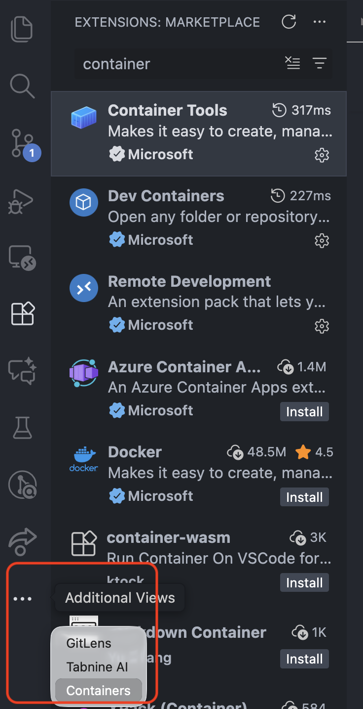
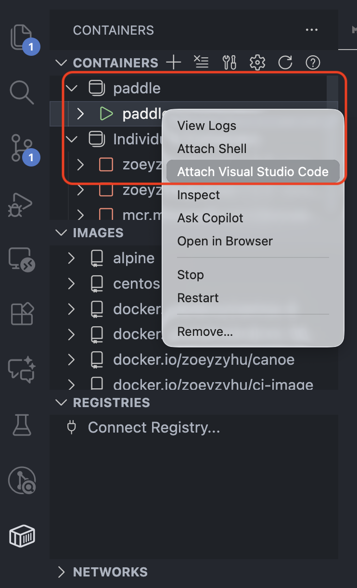
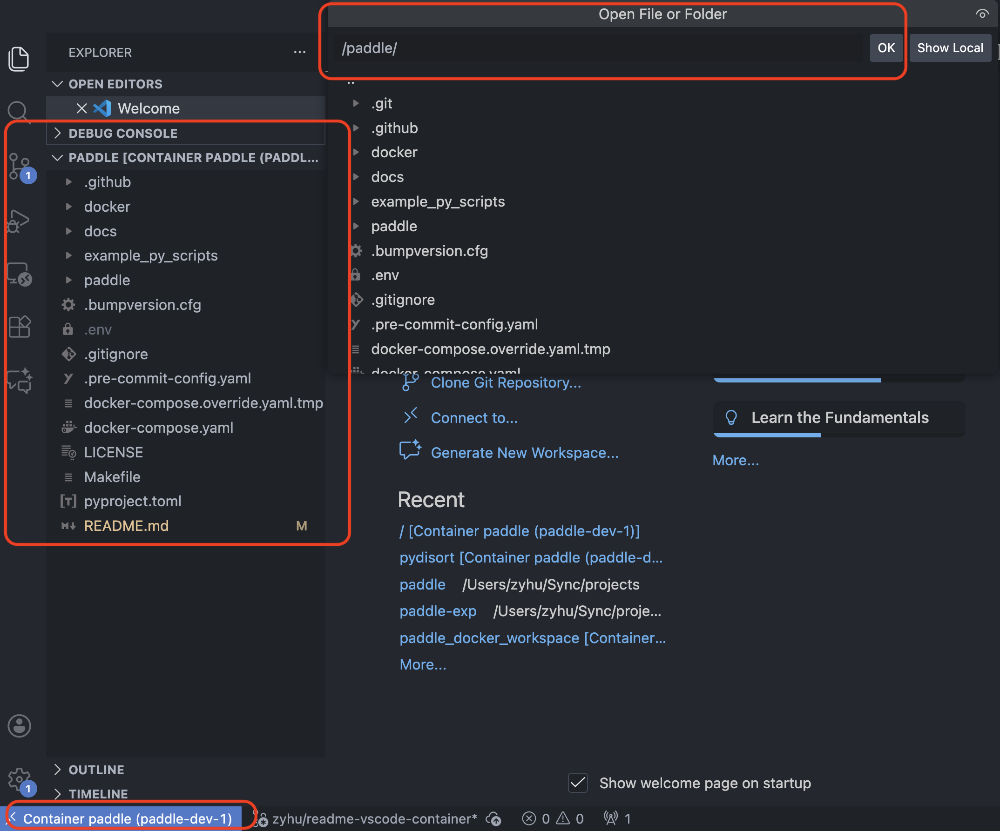

# Paddle

Python Atmospheric Dynamics: Discovering and Learning about Exoplanets. An open-source, user-friendly Python version of [canoe](https://github.com/chengcli/canoe).

## Test the package

Testing the package can be done very easily by following the steps below. All we need is to create a python virtual environment, install the package, and run the test script.

1. Create a python virtual environment

   ```bash
   python -m venv pyenv
   ```

2. Install paddle package

   ```bash
   pip install paddle
   ```

3. Run test

   ```bash
   cd tests
   python test_saturn_adiabat.py
   ```

## Develop with Docker

You may need to install Docker to compose up and install the package inside a container if your device or operating system does not support certain dependencies. Follow the instructions below to install docker and docker-compose plugin.

1. Install docker with compose

   ```bash
   curl -fsSL https://get.docker.com | sudo sh
   ```

2. Start docker using the command below or open docker desktop if applicable.

   ```bash
   sudo systemctl start docker
   ```

After installing Docker, you can use the Makefile commands below to manage your docker containers from the terminal. By default, the container will mount the current directory to `/paddle` inside the container.

> Mounting a local directory allows you to edit files on your local machine while running and testing the code inside the container; or use the container as a development environment and sync files to your local machine.

If you want to change the mounted directory, you can create a `docker-compose.overrides.yml` file based on the provided `docker-compose.overrides.yml.tmp` template file.

- Create a docker container

  ```bash
  make up
  ```

- Start a docker container (only if previously created)

  ```bash
  make start
  ```

- Terminate a docker container

  ```bash
  make down
  ```

- Build a new docker image (rarely used)

  ```bash
  make build
  ```

If you use VSCode, it is recommended to install extensions including [Remote Development](https://marketplace.visualstudio.com/items?itemName=ms-vscode-remote.vscode-remote-extensionpack), [Dev Containers](https://marketplace.visualstudio.com/items?itemName=ms-vscode-remote.remote-containers) and [Container Tools](https://marketplace.visualstudio.com/items?itemName=ms-azuretools.vscode-containers) for a better development experience within a container.

1. Install the extensions mentioned above.
2. Start the container using `make up` or `make start`.
3. Open VSCode and click on the "Containers" icon on the left sidebar. Note that if you have too many extensions installed, the icon may be hidden under the "..." menu.

   
   

4. Right click on the running container named `paddle` with a green triangle icon (indicating it is running), and select "Attach Visual Studio Code" (see above images). This will open a new VSCode window connected to the container.
5. Open either the default folder `paddle` mounted from your local machine, or any custom workspace folder you have set up inside the `docker-compose.overrides.yml` file. Now you can start developing inside the container as if you were working on your local machine!

   

## For Developers

Follow the steps below to set up your development environment.

1. Clone the repository

   ```bash
   https://github.com/elijah-mullens/paddle
   ```

2. Cache your github credential. This will prevent you from being prompted for your username and password every time you push changes to github.

   ```bash
   git config credential.helper 'cache --timeout=86400'
   ```

3. Create a python virtual environment.

   ```bash
   python -m venv .pyenv
   ```

4. Install paddle package

   ```bash
   # Install the package normally
   pip install paddle

   # [Alternatively] if you want to install in editable mode
   pip install -e .
   ```

5. Install pre-commit hook. This will automatically format your code before each commit to ensure consistent code style.

   ```bash
   pip install pre-commit
   pre-commit install
   ```

## Cubed-Sphere Remapping

`paddle` can remap Snapy stitched cubed-sphere NetCDF outputs to a rectilinear
lat-lon grid with TempestRemap-generated offline weights.

See [docs/README_REMAP.md](docs/README_REMAP.md) for a step-by-step remapping
guide, including the real `workspace/data` example files, 0.5 degree output,
variable selection, and TempestRemap cache usage.

Example:

```bash
paddle-cs-remap \
  /home/chengcli/scix/workspace/data/sub_neptune_tidallock.out1.00290.nc \
  /home/chengcli/scix/workspace/data/sub_neptune_tidallock.out2.00290.nc \
  remapped.nc \
  --nlat 181 \
  --nlon 360
```

The remapper treats Snapy outputs as the 2D stitched 3x2 cubed-sphere mosaic
written by Snapy's NetCDF output code. Scalar fields are remapped directly.
`vel1, vel2, vel3` are rotated to geographic `vel_east, vel_north, vel_up`
before remapping. Bilinear interpolation is the default for Snapy's
cell-centered samples; pass `--method conservative` when integral preservation
is required.

### Install TempestRemap

Preferred option:

```bash
conda install -c conda-forge tempest-remap
```

Helper script:

```bash
./scripts/install_tempestremap.sh conda
```

Source-build fallback:

```bash
./scripts/install_tempestremap.sh source "$HOME/.local/tempestremap"
export PATH="$HOME/.local/tempestremap/bin:$PATH"
```

## Move a Restart onto a Taller Grid

A restart holds raw cell arrays; the grid lives in the YAML. Change `x1max` or
`nx1` and the saved tensors no longer fit, so a long run is otherwise stuck with
the lid it started on. `paddle-regrid` reads a restart, maps every column onto
the grid a second YAML describes, and writes one the new configuration accepts.
The clock, cycle counter and output numbering carry across unchanged.

```bash
paddle-regrid --old-config old.yaml --new-config new.yaml \
    --restart run.final.restart --output run.taller.restart
```

Density is mapped log-linearly in height, which is exact on an isothermal
hydrostatic column and continues above the old lid along a fitted slope.
Momentum, tracers and pressure travel as per-mass ratios; total energy travels
as internal energy and is rebuilt from the interpolated velocities, so the
conserved state still matches its own momentum. Condensates start empty above
the old top unless `--keep-condensate` is given, since holding a cloud fraction
at the old edge fills the new column with cloud that was never there.

What it assumes, and what it refuses:

| | |
|---|---|
| grid | uniform arithmetic cell centres from the YAML bounds; `x1min`, `nx3` and `nghost` must be unchanged |
| horizontal | `nx2` must match unless `--x2-mode stretch` is given, which rescales existing eddies along with the domain |
| state fields | only the four hydro arrays. A restart carrying anything else on the x1 axis, `scalar_s` above all, is refused rather than written at two vertical sizes |
| boundaries | reflecting walls, periodic seams and outflow are rebuilt; outflow ghosts take the outermost active value. Anything else is refused. Snapy does not refill ghosts on load, so a wrong ghost is read as the real condition. Snapy's *characteristic* outflow is not supported: its restart carries boundary reference tensors this tool does not map, and it is refused by name |
| hydrostatic balance | the extension is isothermal at each column's edge temperature. A *column* spanning more than 10% in `P/rho` over the fitted cells is refused unless `--allow-nonisothermal` is given; a horizontal temperature gradient is fine, since every column is fitted on its own. Gravity is never read, so balance is approximated, not verified |
| conservation | not enforced. Column mass and energy move by the interpolation error plus whatever the extension adds |
| output | written to a temporary file and renamed into place. An existing destination needs `--force`, and `--restart` may not equal `--output` |

Run `paddle-regrid --help` for the full option list.

## Monitor Remote Machines

`paddle monitor` displays CPU, GPU, process, and local disk usage for a list of
machines accessible through password-less SSH.

Create `~/.config/paddle/nodelist` with one SSH host or alias per line:

```text
# Dart workstations
dart1
dart2
dart3
```

Run a snapshot, continuously refresh the display, or emit JSON:

```bash
paddle monitor
paddle monitor --watch 5
paddle monitor --json
paddle monitor --nodelist path/to/nodelist --top 10 --timeout 15
```

The remote machines need standard Linux tools and `/proc`. GPU metrics are
collected when `nvidia-smi` is available. Nodes are probed concurrently using
multiple threads. Individual unreachable machines are reported without
preventing collection from the remaining nodes.

## Submit Jobs to Remote Machines

`paddle submit` starts a detached command on an explicitly selected machine
from the same nodelist used by `paddle monitor`:

```bash
paddle submit dart1 -- python train.py --epochs 10
paddle submit dart1 --cwd ~/work -- python train.py
paddle submit dart1 --log ./train.log --json -- python train.py
paddle submit dart1 --file train.py --file input.yaml -- python train.py
paddle submit dart1 --nodelist path/to/nodelist --timeout 15 -- ./run.sh
```

The command validates that the host is in the nodelist and connects using
password-less SSH. Without `--log`, the command runs in the foreground and its
output is displayed in the submitting terminal. Pressing Ctrl-C terminates the
SSH connection and terminates the remote foreground command's process group and
descendant processes. With `--log REMOTE_PATH`, the command runs in the remote
background, writes output to that remote path, and reports its remote PID.

Jobs run from the remote home directory by default; use `--cwd` to select
another remote directory. Before executing the command, the remote launcher
sources `${HOME}/.bash_profile`, including aliases when their startup scripts
permit non-interactive use. Arguments after `--` are executed literally; use
an explicit shell command such as
`sh -lc 'python train.py | tee summary.txt'` when pipes, redirects, or other
shell expressions are needed.

Repeat `--file PATH` to copy local regular files into the remote working
directory before execution. Each file keeps its local permission bits and is
placed under its basename, atomically replacing an existing remote file with
the same name. Directories and duplicate basenames are rejected.

## Troubleshooting

1. If you have Docker installed but do not have Docker Compose, remove your current Docker installation, which could be docker or docker.io, and re-install it following the guide provided in the [Develop with Docker](#develop-with-docker) section above.

2. If you run out of disk space while building the image. You can relocate the default location for container images:
Here is a simple recipe:

    1. Generate config (if you don’t already have one):
    ```
    sudo mkdir -p /etc/containerd
    containerd config default | sudo tee /etc/containerd/config.toml >/dev/null
    ```

    2. Edit `/etc/containerd/config.toml` and set:
    ```
    root = "/home/containerd"   # location where you have space
    state = "/run/containerd"
    ```

    3. Restart
    ```
    sudo systemctl restart containerd
    ```

### Cubed-sphere Python API

Restart and remapping functions are grouped under `paddle.cubed_sphere`:

```python
from paddle.cubed_sphere import (
    shrink_cubed_sphere_restart,
    expand_cubed_sphere_restart,
    remap_cubed_sphere_files,
)
from paddle.cubed_sphere.cubed_sphere_utils import draw_panel_seam
```

The `paddle cs-shrink`, `paddle cs-expand`, and `paddle cs-remap` commands
keep their names. Reinstall the package after updating to refresh the
`paddle-cs-*` console entry points. Geometry plotting requires Matplotlib.
The equations, layouts, and examples are in
[the cubed-sphere technical note](docs/notes/cubed_sphere/index.rst), included
in [Paddle notes](docs/notes/paddle_notes.pdf).
