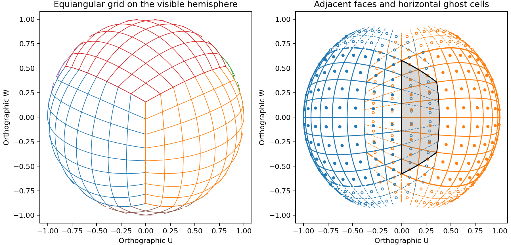
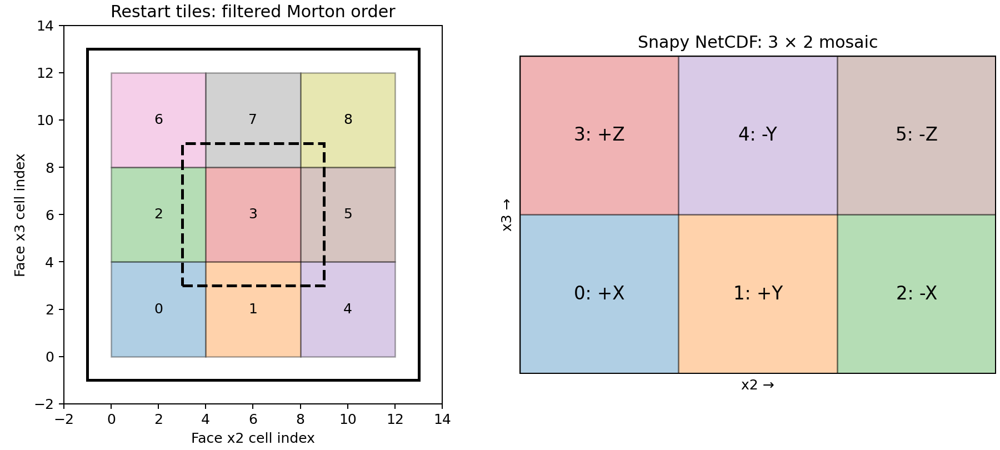

4. Cubed-sphere geometry, restarts, and remapping
=================================================

Scope and public interface
--------------------------

The radiation example in :doc:`../radiation/index` evolves fields on six
cube faces. The functions in ``paddle/cubed_sphere`` describe that geometry,
repartition restart tensors, and convert stitched output to geographic grids.
They serve three distinct purposes:

* ``cubed_sphere_utils`` maps face coordinates to the sphere and draws grids,
  seams, corners, and ghost regions.
* ``shrink_cubed_sphere_restart`` and ``expand_cubed_sphere_restart`` change
  the number of restart blocks while preserving the physical resolution.
* ``remap_cubed_sphere_files`` interpolates NetCDF fields to a regular
  latitude–longitude grid, rotating local vector components first.

The main file operations are exported from the package:

.. code-block:: python

   from paddle.cubed_sphere import (
       shrink_cubed_sphere_restart,
       expand_cubed_sphere_restart,
       read_restart_bundle_index,
       remap_cubed_sphere_files,
   )
   from paddle.cubed_sphere.cubed_sphere_utils import (
       gnomonic_equiangular_to_xyz,
       orthographic_project,
       panel_ab_limits,
       draw_panel_seam,
   )

The plotting helpers require NumPy and Matplotlib. Restart operations use
CPU PyTorch tensors; NetCDF remapping uses NumPy, SciPy sparse matrices,
and netCDF4. TempestRemap executables are needed to generate a new map,
but an existing cached map can be applied without launching them.

Equiangular face coordinates
----------------------------

Let :math:`\alpha,\beta` be face angles in radians. The interior of each
face spans :math:`[-\pi/4,\pi/4]^2`. Set

.. math::

   a=\tan\alpha,\qquad b=\tan\beta,\qquad
   D=\sqrt{1+a^2+b^2}.

``gnomonic_equiangular_to_xyz`` constructs an unnormalized Cartesian vector
:math:`\boldsymbol q` and returns :math:`\boldsymbol r=\boldsymbol q/D`.
The coordinates lie on the unit sphere; multiply by radius for positions.

.. list-table:: Face convention shared with Snapy
   :header-rows: 1

   * - Face index
     - Face
     - :math:`\boldsymbol q`
   * - 0
     - +X
     - :math:`(1,a,b)`
   * - 1
     - +Y
     - :math:`(-a,1,b)`
   * - 2
     - -X
     - :math:`(-1,-a,b)`
   * - 3
     - +Z
     - :math:`(-b,a,1)`
   * - 4
     - -Y
     - :math:`(a,-1,b)`
   * - 5
     - -Z
     - :math:`(b,a,-1)`

Longitude and latitude follow from

.. math::

   \lambda=\operatorname{atan2}(r_y,r_x),\qquad
   \phi=\arcsin(r_z).

The remapper's ``lonlat_to_face_ab`` performs the inverse for a specified
face. For +X it evaluates :math:`\alpha=\operatorname{atan2}(r_y,r_x)`
and :math:`\beta=\operatorname{atan2}(r_z,r_x)`; the other faces use the
signed permutations above. It does not choose the containing face.

Equal angular spacing is not equal area. Differentiating the +X map gives
the surface Jacobian, with the same value on each rotated face:

.. math::

   dA=R^2\frac{(1+a^2)(1+b^2)}{(1+a^2+b^2)^{3/2}}\,d\alpha\,d\beta.

This explains why cell counts alone cannot weight a global integral.
Radiation heating uses Snapy's actual areas and volumes; remapping uses
weights from the generated source and destination meshes.

Orthographic views and ghost regions
------------------------------------

``orthographic_project`` normalizes the viewing direction to
:math:`\boldsymbol V`. Given an auxiliary up direction :math:`\boldsymbol h`
not parallel to it, the image basis is

.. math::

   \boldsymbol e_1=
   \frac{\boldsymbol h\times\boldsymbol V}
        {|\boldsymbol h\times\boldsymbol V|},\qquad
   \boldsymbol e_2=\boldsymbol V\times\boldsymbol e_1,
   \qquad U=\boldsymbol r\cdot\boldsymbol e_1,\quad
   W=\boldsymbol r\cdot\boldsymbol e_2.

``plot_on_face`` and ``scatter_on_face`` retain samples with
:math:`\boldsymbol r\cdot\boldsymbol V>0`. ``visible_segments`` splits a
sampled line into contiguous visible runs. ``sample_edge`` and
``make_poly_patch`` construct sampled polygon boundaries. This is a plotting
approximation, not an exact spherical polygon-clipping or area algorithm.

For :math:`N` interior cells per face edge and :math:`g` ghost cells,

.. math::

   \Delta\theta=\frac{\pi}{2N},\qquad
   \theta_{\min}=-\frac{\pi}{4}-g\Delta\theta,\qquad
   \theta_{\max}=\frac{\pi}{4}+g\Delta\theta.

``panel_ab_limits((dx, dy), N, g, exterior=True)`` selects exterior slabs
or corners using offsets in ``{-1, 0, 1}``. A zero offset retains the
interior span in that dimension, except ``(0, 0)``, which returns the full
face with ghosts. With ``exterior=False``, nonzero offsets select equally
wide strips just inside the face boundary.

``draw_single_panel``, ``draw_panel_seam``, and ``draw_panel_corner`` combine
these operations. The examples use even :math:`N`, matching the centered
index construction in ``draw_panel_grid``. Ghost extensions should stay
away from the tangent singularities at :math:`\pm\pi/2`.

   Left: six-face geometry viewed from the positive octant; hidden portions
   are culled. Right: +X and +Y panels with two ghost cells on an eight-cell
   face. Overlapping ghost regions are representations of neighboring
   physical locations, not additional surface area.

The static and interactive viewers can be launched as modules:

.. code-block:: bash

   python -m paddle.cubed_sphere.plot_cubed_sphere_panel
   python -m paddle.cubed_sphere.cubed_sphere_ui

Restart repartitioning without interpolation
--------------------------------------------

Restart spatial tensors have trailing dimensions ``(x3, x2, x1)``; any
leading dimensions, such as variable index, are preserved. A face subdivided
into :math:`n\times n` blocks contributes :math:`n^2` entries to a bundle,
so the complete sphere has :math:`6n^2` blocks. Faces follow the table above.
Within a face, ranks follow filtered Morton (Z) order: interleave the binary
bits of the horizontal block coordinates and skip coordinates outside
:math:`0\le x,y<n`. This also supports non-power-of-two subdivisions.

For example, :math:`n=2` visits
:math:`(0,0),(1,0),(0,1),(1,1)`. The restart routines use the same order
when interpreting input ranks and assigning output ranks.

``shrink_cubed_sphere_restart`` combines :math:`6n^2` blocks into six face
blocks. If a tile has :math:`m_2,m_3` interior cells, its stored horizontal
shape is :math:`(m_3+2g,m_2+2g)`, and the stitched face shape is

.. math::

   (nm_3+2g,\;nm_2+2g).

Internal ghost strips are discarded. Only the ghost strips along the outer
face edges survive; the radial axis is copied in full. No averaging, vector
rotation, or change of resolution occurs.

``expand_cubed_sphere_restart`` reverses the layout operation. The face
interior dimensions must be divisible by :math:`n`. For tile :math:`(x,y)`,
it extracts the stored face slice

.. code-block:: python

   face[..., y*m3:(y+1)*m3+2*g, x*m2:(x+1)*m2+2*g, :]

The overlapping slices provide neighboring interior values as internal
ghosts. Expanding and then shrinking a face reproduces the original face
tensor. Shrinking and then expanding preserves interiors and outer ghosts,
but replaces old internal ghost values with values from the stitched face.

The bundle reader checks the ``SNAPY_RESTART_BUNDLE_V1`` index and payload
sizes. Tensors with fewer than three dimensions are treated as metadata;
metadata must agree between blocks. Six worker processes handle the faces.
Both file operations require positive ghost width and a new output path.

   Left: local ranks within one face for :math:`n=3`. The dashed box is the
   central tile including one ghost cell; the outer black box bounds the
   stitched face including its exterior ghosts. Right: NetCDF face positions
   in increasing x2 and x3 order. This mosaic is a storage layout, not a
   geometrically unfolded cube.

.. code-block:: python

   shrink_cubed_sphere_restart("tiles.restart", "faces.restart", nghost=3)
   expand_cubed_sphere_restart("faces.restart", "new_tiles.restart", n=2, nghost=3)

.. code-block:: bash

   python -m paddle cs-shrink tiles.restart faces.restart --nghost 3
   python -m paddle cs-expand faces.restart new_tiles.restart --n 2 --nghost 3

Mosaic ordering and vector rotation
-----------------------------------

NetCDF source fields have trailing dimensions ``(2N, 3N)`` for six square
faces. ``infer_mosaic_layout`` checks these dimensions, and
``split_stitched_mosaic`` returns ``(..., 6, N, N)``. This input is already
stitched output; the remapper does not remove restart ghost zones. Source
``lon`` and ``lat`` arrays are read at their first time index and must be
in radians, matching Snapy output.

``reorder_faces_to_tempest`` changes the face order using indices
``[0, 1, 2, 4, 5, 3]``, giving +X, +Y, -X, -Y, -Z, +Z.
``flatten_faces`` then flattens face, row, and column in row-major order.
The same permutation must be used for every scalar and vector component.

Snapy's ``vel1, vel2, vel3`` are local components, not geographic east,
north, and up. Let their values be :math:`v_1,v_2,v_3`, and define
:math:`C=\sqrt{1+a^2}`, :math:`E=\sqrt{1+b^2}`. The implemented local
Cartesian transformation is

.. math::

   v_z^{\rm loc}=\frac{v_1-v_2a/E-v_3b/C}{D},\qquad
   v_x^{\rm loc}=\frac{v_1a+v_2E-v_3ab/C}{D},\qquad
   v_y^{\rm loc}=\frac{v_1b+v_3C-v_2ab/E}{D}.

Here local z points toward the face center, x follows increasing alpha,
and y follows increasing beta. Apply the same face permutation as for
:math:`\boldsymbol q` to obtain global :math:`(v_x,v_y,v_z)`. Then
``rotate_vector_faces_to_geographic`` evaluates

.. math::

   v_E=-\sin\lambda\,v_x+\cos\lambda\,v_y,

   v_N=-\sin\phi\cos\lambda\,v_x
       -\sin\phi\sin\lambda\,v_y+\cos\phi\,v_z,

   v_U=\cos\phi\cos\lambda\,v_x
       +\cos\phi\sin\lambda\,v_y+\sin\phi\,v_z.

Rotation happens at source-cell locations before remapping each geographic
component. The standard triplet produces ``vel_east``, ``vel_north``, and
``vel_up``. This component-wise remapping is not a divergence-preserving or
kinetic-energy-conserving vector transport scheme.

Sparse remapping to latitude–longitude
--------------------------------------

TempestRemap generates a cubed-sphere mesh, a regular latitude–longitude
mesh, their overlap mesh, and an offline map. Paddle loads the map's row,
column, and weight arrays into a SciPy CSR matrix :math:`M`, then applies

.. math::

   q_j^{\rm dst}=\sum_i M_{ji}q_i^{\rm src}.

Leading time and vertical dimensions are processed as independent fields.
The output is reshaped to ``(time, altitude, lat, lon)``. Latitude and
longitude coordinates are cell centers in degrees; altitude and time come
from the source file.

The default ``bilinear`` option requests TempestRemap's ``bilin`` method.
The ``conservative`` option requests first-order finite-volume remapping
without that override. For complete source and target coverage, conservative
weights represent overlap area divided by destination-cell area:

.. math::

   M_{ji}=\frac{A(S_i\cap D_j)}{A(D_j)},\qquad
   \sum_j A(D_j)q_j^{\rm dst}=\sum_i A(S_i)q_i^{\rm src}.

Thus the conservative method preserves area integrals of the supplied scalar
cell averages; it does not automatically preserve mass or energy when the
supplied field is a primitive variable. Bilinear interpolation is intended
for smooth pointwise fields and has no such area-integral guarantee.

Map files are cached by face resolution, target resolution, and method.
The cache assumes the standard equiangular cube orientation and a regular
latitude–longitude destination. It does not encode an arbitrary deformed
source mesh. Multiple source files must describe the same grid and time
samples and have distinct non-coordinate variable names.

.. code-block:: python

   remap_cubed_sphere_files(
       ["atmosphere.nc"], "latlon.nc", nlat=90, nlon=180,
       scalar_vars=["rho", "press"], remap_method="conservative",
   )

.. code-block:: bash

   python -m paddle cs-remap atmosphere.nc latlon.nc \
       --nlat 90 --nlon 180 --remap-method conservative

Reproduction and checks
-----------------------

The :download:`figure generator <generate_figures.py>` uses the geometry
functions and Morton ordering from this package. It writes PNG and SVG
figures next to this section:

.. code-block:: bash

   MPLCONFIGDIR=/tmp/paddle-matplotlib \
       python docs/notes/cubed_sphere/generate_figures.py
   OMP_NUM_THREADS=1 python -m pytest tests/test_cubed_sphere*.py \
       tests/test_restart_resize.py tests/test_restart_horizontal_stats.py -q

Tests cover all six face-coordinate inverses, ghost-region bounds, public
imports and CLI targets, restart round trips and metadata checks, face
ordering, Cartesian-to-geographic vector recovery, and sparse-map application.
The combined document is built using the instructions in :doc:`../index`;
this section does not create a separate PDF.
