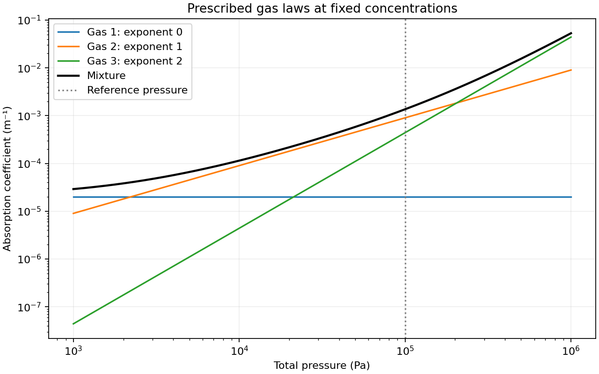
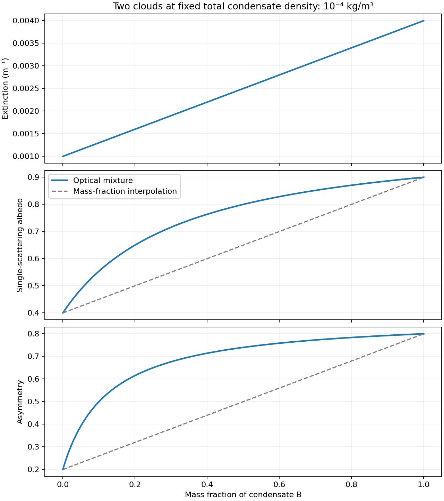

Batched gas and cloud opacity
=============================

Scope and interface
-------------------

``paddle/rt/opacity.py`` provides two simple grey optical-property modules:
``GasOpacity`` combines pressure-dependent absorption from several gases,
and ``CloudOpacity`` combines extinction and scattering from several
condensates. These are prescribed parameterizations, not line-by-line gas
spectroscopy or particle-size-dependent cloud scattering calculations.

Batching is over the **selected species**. Each parameter list follows the
order of ``species_indices``, which selects the last axis of ``conc``. The
module sums these contributions into one mixture. The leading output axis
has length one and represents one grey spectral band, not a species batch.
Use separate module instances for bands with different coefficients.

.. list-table:: Input and output conventions
   :header-rows: 1
   :widths: 25 35 40

   * - Quantity
     - Shape / units
     - Meaning
   * - ``conc``
     - ``(ncol, nlyr, nspecies)``, mol/m³
     - Molar concentration of every species
   * - ``pres``
     - ``(ncol, nlyr)``, Pa
     - Total pressure, shared by all gas species
   * - ``temp``
     - ``(ncol, nlyr)``, K
     - Accepted for the opacity interface; unused
   * - ``molecular_weights``
     - List of length ``nselected``, kg/mol
     - Molar masses of selected gases or condensates
   * - Output
     - ``(1, ncol, nlyr, 3)``
     - Extinction in 1/m, single-scattering albedo, asymmetry

In particular, molar mass must be in **kg/mol**, not g/mol. For water use
approximately ``0.018``, not ``18``. Condensate concentration is the number of
moles of condensate material per volume, not the number of cloud particles.

Each species list must have the same nonzero length. Gas ``p_ref`` is one
positive Python float for the whole mixture, defaulting to ``1.e5`` Pa
(1 bar). The constructor order is ``species_indices, molecular_weights,
kappa_ref, exponent, p_ref=1.e5``; use ``p_ref=...`` to override it.
Floating coefficient lists are
registered buffers, as are integer species indices. Move the module to the
input device and floating dtype once before evaluation, for example
``opacity.to(device=conc.device, dtype=conc.dtype)``. Indices remain integers.
These column/layer/species calculations run on the input device; no per-cell
Python loops or GPU-to-CPU transfers are needed.

Gas absorption
--------------

Let :math:`c_i` be the selected molar concentration and :math:`M_i` the molar
mass of gas :math:`i`. Its mass density and mass absorption coefficient are

.. math::

   \rho_i=c_i M_i,\qquad
   \kappa_i(p)=\kappa_{{\rm ref},i}
      \left(\frac{\max(p,0)}{p_{\rm ref}}\right)^{n_i}.

Here ``kappa_ref[i]`` has units m²/kg and ``exponent[i]`` is dimensionless.
All species share the same total pressure and the same reference pressure;
this is not a partial-pressure law. The final extinction is purely absorbing:

.. math::

   \beta_{\rm gas}=\sum_i \rho_i\kappa_i(p),\qquad
   \omega_{\rm gas}=0,\qquad g_{\rm gas}=0.

The implementation keeps the species axis until after multiplying density
by its own coefficient. For example, with two species,
:math:`\rho_1\kappa_1+\rho_2\kappa_2` cannot generally be replaced by a
single coefficient times :math:`\rho_1+\rho_2`.

``pres.unsqueeze(-1)`` adds the species axis to pressure. Multiplying by the
one-dimensional parameter buffers broadcasts the individual pressure laws
over every column and layer. The final ``sum(-1)`` removes only the species
axis. Temperature has no explicit role; it may already affect the supplied
concentrations through the atmospheric state.

Negative pressure is clamped to zero, retaining the original module's
behavior. For positive exponents the opacity at zero pressure is zero; for
zero exponent the pressure factor is one. Negative exponents require strictly
positive pressure: zero pressure makes that power law singular. A zero
concentration multiplied by an infinite coefficient can also produce NaN.
The module does not regularize this singular model. Supply nonnegative finite
concentrations and coefficients and physically valid pressure.

Cloud extinction and scattering
-------------------------------

Each condensate has its own ``molecular_weights``, ``mass_extinction``,
``single_scattering_albedo``, and ``asymmetry`` entry. The parameter name
``mass_extinction`` denotes a list of extinction coefficients in m²/kg of
that condensate. For condensate :math:`j`,

.. math::

   \rho_j=c_jM_j,\qquad
   \beta_j=\rho_j K_j,\qquad
   \sigma_j=\omega_j\beta_j.

Here :math:`K_j` is mass extinction, :math:`\omega_j` is single-scattering
albedo, and :math:`\sigma_j` is scattering per length. Absorption per length
is :math:`(1-\omega_j)\beta_j`. Physical inputs obey :math:`K_j\ge0`,
:math:`0\le\omega_j\le1`, and :math:`-1\le g_j\le1`.
Pressure and temperature are unused for the prescribed cloud coefficients.

The mixture must conserve extinction and scattering, and its asymmetry must
preserve the first angular moment of scattering [Mixing]_. This gives

.. math::

   \beta=\sum_j\beta_j,\qquad
   \sigma=\sum_j\sigma_j,\qquad
   \omega=\frac{\sigma}{\beta},\qquad
   g=\frac{\sum_j\sigma_j g_j}{\sigma}.

Thus albedo is **extinction-weighted**, while asymmetry is
**scattering-weighted**. Neither quantity should be summed or averaged
arithmetically. A purely absorbing cloud adds extinction but does not change
the asymmetry of the scattering material.

When extinction is zero, the module returns ``(0, 0, 0)``. When extinction
is positive but scattering is zero, it returns ``(beta, 0, 0)``. Albedo and
asymmetry are physically irrelevant in these respective limits, so zero is
an explicit numerical convention. The code replaces a zero denominator with
one before dividing; the corresponding numerator is zero for physical inputs.
This avoids division by zero even in branches evaluated by PyTorch, and keeps
backpropagation finite at an empty cloud. It does not assign a physically
unique derivative to the undefined mixture ratios at that point.

For one nonempty scattering condensate, the mixture recovers its prescribed
albedo and asymmetry exactly (up to numerical roundoff).

Hand-checkable examples
-----------------------

Gas example: at :math:`p=p_{\rm ref}`, let selected concentrations be
:math:`(5,4)` mol/m³, molar masses :math:`(0.02,0.01)` kg/mol, and reference
opacities :math:`(2,3)` m²/kg. Then

.. math::

   \beta_{\rm gas}=5(0.02)(2)+4(0.01)(3)=0.32\ {\rm m}^{-1}.

Cloud example: extinction contributions :math:`(0.2,0.4)` m⁻¹, albedos
:math:`(0.5,1.0)`, and asymmetries :math:`(0.2,0.8)` give

.. math::

   \beta=0.6\ {\rm m}^{-1},\quad \sigma=0.5\ {\rm m}^{-1},\quad
   \omega=\frac56,\quad
   g=\frac{0.1(0.2)+0.4(0.8)}{0.5}=0.68.

These values are reproduced directly by:

.. code-block:: python

   import torch
   from paddle.rt.opacity import GasOpacity, CloudOpacity

   conc = torch.tensor([[[4., 999., 5.]]], dtype=torch.float64)
   pres = torch.tensor([[1.e5]], dtype=torch.float64)
   temp = torch.tensor([[300.]], dtype=torch.float64)
   gas = GasOpacity([2, 0], [0.02, 0.01], [2., 3.], [1., 2.])
   gas_properties = gas(conc, pres, temp)  # [[[[0.32, 0, 0]]]]

   cloud = CloudOpacity([2, 0], [0.02, 0.01], [10., 20.],
                        [0.5, 1.0], [0.2, 0.8])
   condensates = torch.tensor([[[2., 999., 1.]]], dtype=torch.float64)
   cloud_properties = cloud(condensates, pres, temp)
   # [[[[0.6, 0.833333..., 0.68]]]]

Species 1 is deliberately omitted despite its large concentration. The
parameters align with ``[2, 0]`` rather than the original concentration order.
The numerical coefficients are illustrative, not calibrated material data.

Using the output in radiative transfer
--------------------------------------

Extinction is a coefficient per length, not optical thickness. For a
homogeneous layer of thickness :math:`\Delta z`,

.. math::

   \tau=\beta\Delta z.

Only the first output property is multiplied by layer thickness:

.. code-block:: python

   prop = cloud(conc, pres, temp)
   prop[..., 0] *= dz.view(1, 1, -1)  # dz is (nlyr,) in meters

Albedo and asymmetry are dimensionless and must stay unchanged. At the time
of writing, the existing helpers in ``two_stream_solvers.py`` multiply the
whole property array by ``dz``. That conversion must be corrected before
using them with nonzero scattering properties from ``CloudOpacity``.

Likewise, gas and cloud output arrays cannot simply be added. If their
extinctions are :math:`\beta_g,\beta_c` and the cloud properties are
:math:`\omega_c,g_c`, then for this purely absorbing gas model,

.. math::

   \beta_{\rm total}=\beta_g+\beta_c,\qquad
   \omega_{\rm total}=\frac{\beta_c\omega_c}{\beta_g+\beta_c},\qquad
   g_{\rm total}=g_c

when cloud scattering is nonzero. Use zero for undefined ratios, as above.
The opacity classes do not perform this gas-plus-cloud combination themselves.

Examples and reproducible figures
---------------------------------

   Three prescribed gas laws at fixed concentrations. Their exponents are
   0, 1, and 2; all share a reference pressure of 100 kPa. Varying pressure
   at fixed concentration isolates the coefficient law, rather than tracing
   a thermodynamically consistent atmosphere.

   Two condensates at fixed total mass density, with different extinction
   efficiencies, albedos, and asymmetries. Increasing condensate B's mass
   fraction changes both weights. The dashed curves show the generally
   incorrect arithmetic interpolation of albedo and asymmetry by mass fraction.

The :download:`figure-generation script <generate_figures.py>` evaluates
``GasOpacity`` and ``CloudOpacity`` directly. It writes PNG and SVG versions
under ``figures/``; ``--output-dir`` chooses another directory. From the
repository root, with Paddle's dependencies and Matplotlib installed:

.. code-block:: bash

   MPLCONFIGDIR=/tmp/paddle-matplotlib python docs/notes/opacity/generate_figures.py
   python -m pytest tests/test_opacity.py -q
   python -m sphinx -W -b html docs/notes /tmp/paddle-notes-html

References
----------

.. [Mixing] Mukherjee et al., `Equivalence of internal and external mixture schemes
   of single scattering properties in vector radiative transfer
   <https://pmc.ncbi.nlm.nih.gov/articles/PMC5774337/>`_, Applied Optics (2017).
   This note uses the additive-coefficient and scattering-moment definitions;
   its prescribed grey gas/cloud coefficients are not taken from that study.
