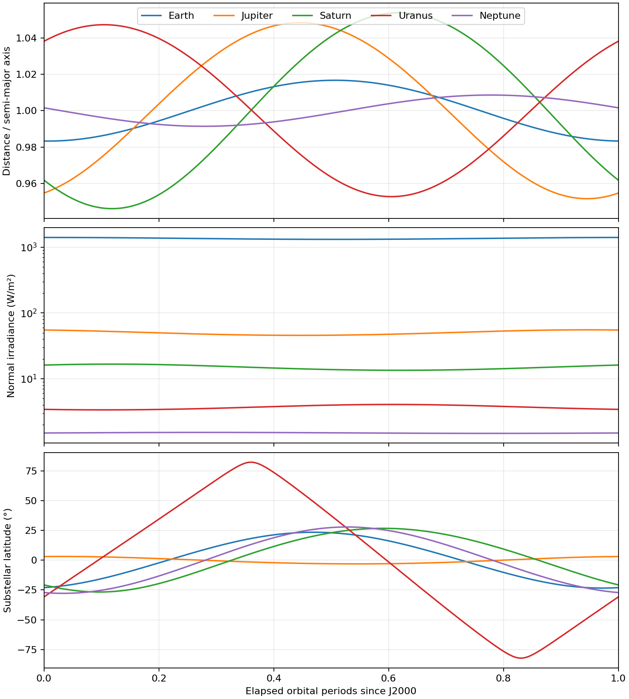
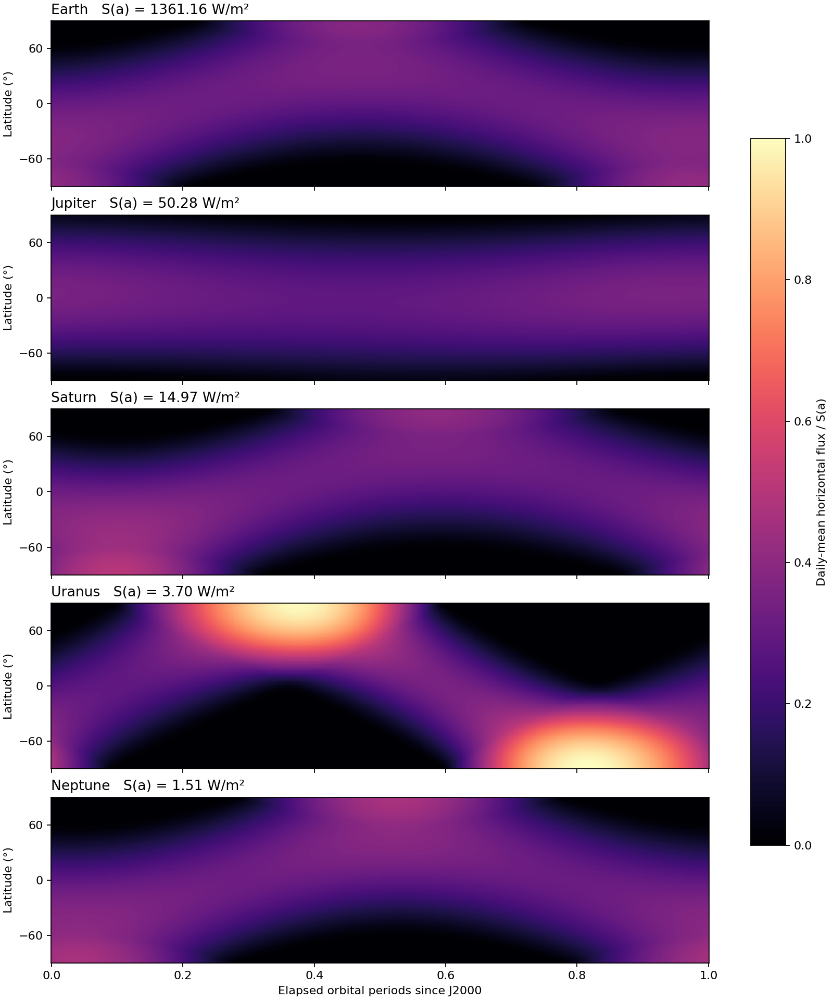

1. Orbital illumination
=======================

Scope and interface
-------------------

The first step is the radiation arriving at the top of the atmosphere.
``paddle/orbital/orbital.py`` implements ``OrbitalForcing``, a PyTorch module
that supplies this illumination geometry. Its small stage-forcing method also
applies the heating calculated later in :doc:`../radiation/index`.
``paddle/orbital/planets.py`` provides ``Earth``, ``Jupiter``, ``Saturn``,
``Uranus``, and ``Neptune`` subclasses. These are fixed elliptical orbits
for atmospheric experiments, with spherical surfaces and constant spin.
They do not calculate atmospheric absorption or solve radiative transfer.

All dimensional constructor arguments use SI: luminosity in W, semi-major
axis in m, period and time in s, and rotation rate in rad/s. Angles are radians.
Surface longitude is east-positive and latitude is planetocentric. Longitude
and latitude are floating PyTorch tensors with broadcastable shapes on the
same device. Time is a single Python float in seconds. For a time series,
call ``insolation`` once per time, as the figure-generation script does.

Kepler iterations, substellar coordinates, and inverse-square irradiance use
Python scalar math on the CPU. Only the substellar coordinates are converted
to tensors on the grid device; grid-sized incidence and masking run there.
This follows the atmospheric time-stepping interface: one time, many columns.

``insolation(lon, lat, time)`` returns:

* ``mu0``: nonnegative cosine of the stellar zenith angle, zero at night;
* ``beam``: normal-to-ray irradiance in W/m², masked to zero at night;
* ``distance``: star-to-planet distance in m;
* ``substellar_lon``: east longitude in the interval [-pi, pi);
* ``substellar_lat``: planetocentric latitude in [-pi/2, pi/2].

The first two outputs have the broadcast spatial shape. Distance is a Python
float. Substellar longitude and latitude are scalar tensors matching their
respective grid coordinates in dtype and device. Horizontal incident flux is
``mu0 * beam``.

Kepler's equation
-----------------

For eccentricity :math:`0\le e<1`, period :math:`P`, and initial mean
anomaly :math:`M_0`, define

.. math::

   M(t)=M_0+\frac{2\pi t}{P},\qquad M=E-e\sin E.

The implementation wraps :math:`M` to :math:`[-\pi,\pi)` and solves for
:math:`E` with 32 Newton iterations:

.. math::

   E_{k+1}=E_k-\frac{E_k-e\sin E_k-M}{1-e\cos E_k}.

The initial guess is :math:`E_0=M` for :math:`e\le0.8`, otherwise
:math:`E_0=\operatorname{sign}(M)\pi` (positive at zero). The high-eccentricity
start avoids the poor Newton steps near periapsis that occur with :math:`E_0=M`.
The fixed iteration count supports TorchScript; it is not
an adaptive error estimate. Extremely near-parabolic cases require separate
accuracy assessment. For the supplied planets :math:`e<0.054`.

Distance and true anomaly follow:

.. math::

   r=a(1-e\cos E),\qquad
   f=2\operatorname{atan2}\left(\sqrt{1+e}\sin(E/2),
                               \sqrt{1-e}\cos(E/2)\right).

In particular, periapsis and apoapsis are :math:`a(1-e)` and :math:`a(1+e)`.
Only :math:`M` advances uniformly: orbital speed increases near periapsis.

J2000 frames and the seasonal phase
-----------------------------------

For the presets, ``time=0`` denotes JD 2451545.0 TDB (J2000); time is elapsed
TDB seconds, not a UTC timestamp. The orbit is referenced to the **mean
J2000 ecliptic and equinox**. Spin poles are given in the **J2000 equatorial**
frame. These are distinct frames, connected here by a fixed obliquity
:math:`\epsilon_0=23.43928^\circ`.

Let :math:`I` be orbital inclination, :math:`\Omega` ascending-node longitude,
and :math:`\omega=\varpi-\Omega` argument of perihelion. Using active,
right-handed rotations, construct perihelion and transverse unit vectors:

.. math::

   [\mathbf P\ \mathbf Q]=
   R_x(\epsilon_0)R_z(\Omega)R_x(I)R_z(\omega)
   \begin{bmatrix}1&0\\0&1\\0&0\end{bmatrix}.

The heliocentric direction is :math:`\mathbf P\cos f+\mathbf Q\sin f`.
The direction **toward the Sun** has the opposite sign:

.. math::

   \mathbf s=-\mathbf P\cos f-\mathbf Q\sin f.

For pole right ascension :math:`\alpha_p` and declination :math:`\delta_p`,
define a fixed planet-equatorial basis

.. math::

   \mathbf k=(\cos\delta_p\cos\alpha_p,
              \cos\delta_p\sin\alpha_p,\sin\delta_p),\qquad
   \mathbf u=(-\sin\alpha_p,\cos\alpha_p,0),\qquad
   \mathbf v=\mathbf k\times\mathbf u.

The ``solar_basis`` tuple of CPU float constants contains the two columns of
:math:`-[\mathbf u\ \mathbf v\ \mathbf k]^T[\mathbf P\ \mathbf Q]`.
Multiplication by :math:`(\cos f,\sin f)^T` gives :math:`(s_x,s_y,s_z)`.
With prime-meridian angle :math:`W(t)=W_0+\dot Wt`,

.. math::

   \delta_\star=\arcsin s_z,\qquad
   \lambda_\star=\operatorname{wrap}_{[-\pi,\pi)}
          \left[\operatorname{atan2}(s_y,s_x)-W(t)\right].

This construction fixes both the season at J2000 and the longitude origin.
Simply specifying an obliquity and setting all mean anomalies to zero would
incorrectly synchronize the planets' perihelia and seasons.

For a generic ``OrbitalForcing`` without a planet preset, the default basis
instead gives :math:`(s_x,s_y,s_z)=(\cos f,\cos\varepsilon\sin f,
\sin\varepsilon\sin f)`. Thus periapsis coincides with the northern spring
equinox by convention. The preset basis replaces this idealized alignment.
The basis stays on CPU when ``module.to(device)`` is called. Like the scalar
orbital parameters, it is constructor configuration and is not included in
``state_dict``. Reconstruct the same preset/configuration when restoring a
model.

Uranus uses the IAU north pole and negative :math:`\dot W`. Its ``obliquity``
attribute is the angle between the **angular momentum** and orbital normal,
about 98 degrees. The angle between its IAU north pole and orbital normal is
about 82 degrees. Keeping these two conventions distinct preserves the sign
of latitude and retrograde rotation. All presets expose east-positive
longitude, even where published planetary maps use west-positive longitude.

Incident radiation
------------------

At longitude :math:`\lambda` and latitude :math:`\phi`, the outward surface
normal dotted with the stellar direction gives

.. math::

   \mu=\sin\phi\sin\delta_\star+
        \cos\phi\cos\delta_\star\cos(\lambda-\lambda_\star),\qquad
   \mu_0=\max(\mu,0).

The inverse-square irradiance and local horizontal flux are

.. math::

   S(r)=\frac{L_\star}{4\pi r^2},\qquad
   B=S(r)\,\mathbf1_{\mu>0},\qquad F_{\rm horizontal}=\mu_0 B.

A spherical global average is :math:`S/4`. Albedo, atmospheric attenuation,
ring shadows, eclipses, refraction, finite stellar angular size, and internal
heat flux are outside this module.

The normal beam :math:`B` and incidence cosine :math:`\mu_0` are passed
separately to the radiation solver: it applies the projection and optical path
length itself. Multiplying the beam by :math:`\mu_0` before passing it would
apply the projection twice. The :doc:`next section <../opacity/index>` supplies
the material properties needed to turn this boundary illumination into fluxes
through the atmosphere.

Planet presets and provenance
-----------------------------

Orbital elements below are the J2000 values of JPL's Table 1 [JPL]_. The Earth
row represents the Earth-Moon barycenter. The code freezes :math:`a,e,I,
\varpi,\Omega` and uses :math:`M_0=L_0-\varpi_0`. It sets
:math:`P=360^\circ/(\dot L-\dot\varpi)` in Julian centuries, each 36525 days;
this is the adopted anomalistic period, not an independently tabulated
sidereal year. No other secular rates are propagated.

.. csv-table:: J2000 orbital elements (angles in degrees, axis in au)
   :header: "Planet", "a", "e", "I", "L", "varpi", "Omega"
   :widths: 12, 15, 15, 14, 15, 15, 15

   Earth,1.00000261,0.01671123,-0.00001531,100.46457166,102.93768193,0
   Jupiter,5.20288700,0.04838624,1.30439695,34.39644051,14.72847983,100.47390909
   Saturn,9.53667594,0.05386179,2.48599187,49.95424423,92.59887831,113.66242448
   Uranus,19.18916464,0.04725744,0.77263783,313.23810451,170.95427630,74.01692503
   Neptune,30.06992276,0.00859048,1.77004347,-55.12002969,44.96476227,131.78422574

Rotation uses the polynomial constants and linear spin terms in NAIF's
``pck00011.tpc`` [PCK]_. Pole precession and all periodic corrections are
omitted, including Neptune's periodic terms at the epoch. Thus these are
simplified reference orientations, not exact SPICE IAU frames.

.. csv-table:: Adopted rotation coefficients
   :header: "Planet", "Pole RA (deg)", "Pole Dec (deg)", "W0 (deg)", "W rate (deg/day)"

   Earth,0,90,190.147,360.9856235
   Jupiter,268.056595,64.495303,284.95,870.5360000
   Saturn,40.589,83.537,38.90,810.7939024
   Uranus,257.311,-15.175,203.81,-501.1600928
   Neptune,299.36,43.46,249.978,541.1397757

All presets use nominal solar luminosity :math:`3.828\times10^{26}` W
[IAU2015]_ and :math:`1\ {\rm au}=149597870700` m [IAU2012]_. Irradiance at
one au is approximately 1361 W/m². Giant-planet spin conventions represent
reference rotation, not latitude-dependent atmospheric winds.

JPL's published accuracy estimates for its time-dependent approximation do
**not** apply to these frozen-element orbits. Full orbital cycles in the
figures illustrate the periodic model, including beyond JPL Table 1's
1800–2050 fitting interval for the outer planets. The simplified Earth spin
also omits UT1, polar motion, and nutation. Use a numerical ephemeris and an
appropriate orientation model when precise dates, positions, or longitudes
are required.

Examples and reproducible figures
---------------------------------

.. code-block:: python

   import torch
   from paddle.orbital import Earth, Jupiter, Saturn, Uranus, Neptune

   for planet_type in (Earth, Jupiter, Saturn, Uranus, Neptune):
       planet = planet_type()
       zero = torch.tensor(0.0, dtype=torch.float64)
       mu0, beam, r, lon_star, lat_star = planet.insolation(zero, zero, 0.0)
       print(planet_type.__name__, r, lat_star.rad2deg().item())

   earth = Earth()
   lon = torch.linspace(-torch.pi, torch.pi, 361, dtype=torch.float64)[None, :]
   lat = torch.linspace(-torch.pi/2, torch.pi/2, 181, dtype=torch.float64)[:, None]
   mu0, beam, *_ = earth.insolation(lon, lat, 0.0)
   horizontal_flux = mu0 * beam

   Each curve starts at J2000 and spans its own orbital period. Distance is
   normalized by semi-major axis. Normal irradiance shows the large
   interplanetary contrast; substellar latitude shows the seasonal amplitude
   and phase, especially the extreme seasons of Uranus.

   Longitude-averaged horizontal flux, normalized by each planet's irradiance
   at its semi-major axis. This is the daily mean with orbital geometry held
   fixed during a rotation. Separate rows share one color scale, revealing
   polar night, polar summer, and eccentricity modulation.

The :download:`plotting script <generate_figures.py>` evaluates the actual classes for the orbit curves and
uses their distances and substellar latitudes in the analytic longitude
average:

.. math::

   \overline F=\frac{S}{\pi}
      [H_0\sin\phi\sin\delta_\star+
       \cos\phi\cos\delta_\star\sin H_0],\qquad
   H_0=\arccos\!\left[\operatorname{clip}
       (-\tan\phi\tan\delta_\star,-1,1)\right].

Here :math:`H_0=0` is polar night and :math:`H_0=\pi` is continuous daylight.
The grid uses latitude cell centers to avoid evaluating tangents at the poles.

From the repository root, with Paddle's dependencies and Matplotlib installed:

.. code-block:: bash

   MPLCONFIGDIR=/tmp/paddle-matplotlib python docs/notes/orbital/generate_figures.py
   python -m pytest tests/test_orbital.py -q

The script uses a noninteractive backend and writes PNG and SVG versions to
``figures/`` next to itself; ``--output-dir`` selects another destination.

References
----------

.. [JPL] NASA/JPL Solar System Dynamics, `Approximate Positions of the Planets,
   Table 1 <https://ssd.jpl.nasa.gov/planets/approx_pos.html>`_.
.. [PCK] NASA/JPL NAIF, `Planetary constants kernel pck00011.tpc
   <https://naif.jpl.nasa.gov/pub/naif/generic_kernels/pck/pck00011.tpc>`_,
   December 27, 2022; bodies 399, 599, 699, 799, and 899.
.. [IAU2015] IAU 2015 Resolution B3, `Nominal conversion constants
   <https://www.iau.org/static/resolutions/IAU2015_English.pdf>`_.
.. [IAU2012] IAU 2012 Resolution B2, `Re-definition of the astronomical unit
   <https://www.iau.org/static/resolutions/IAU2012_English.pdf>`_.
