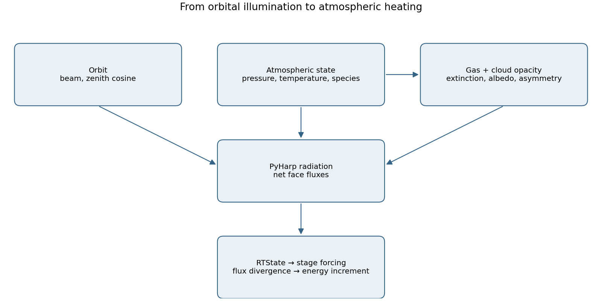
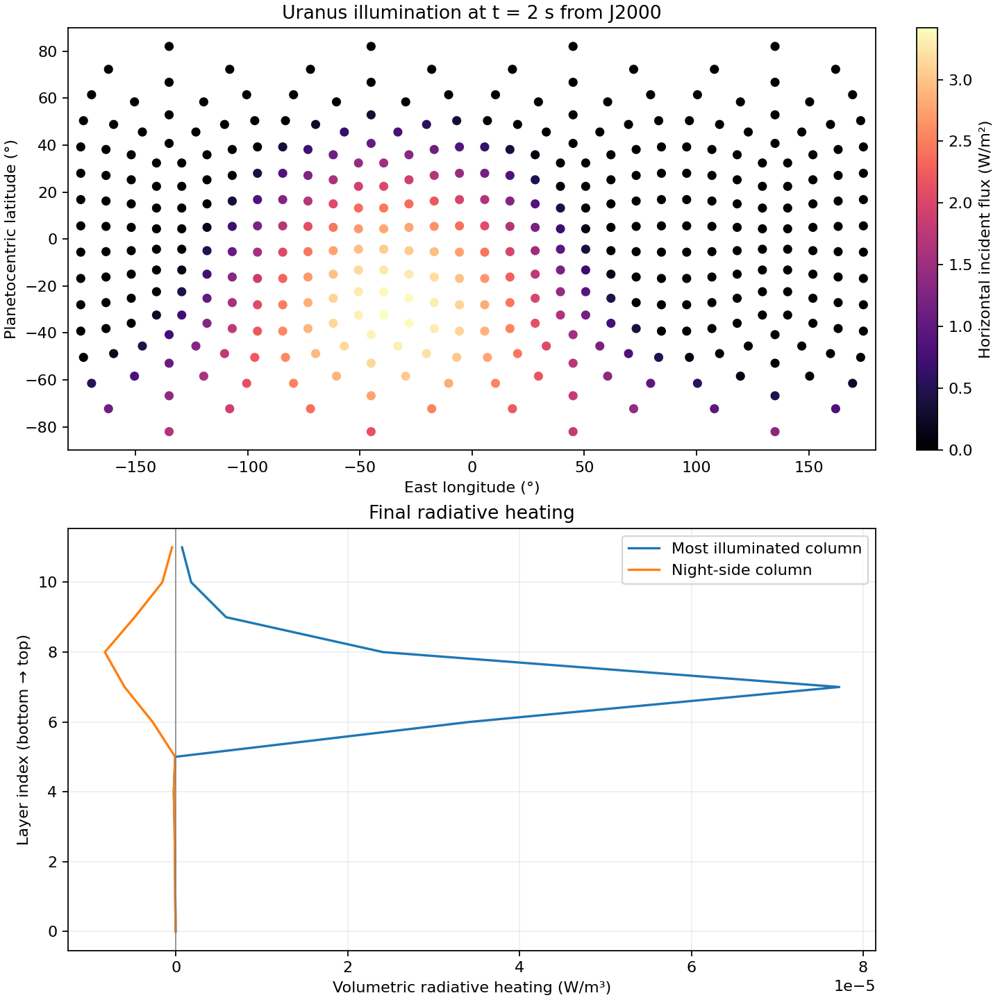

3. Radiation state and the Uranus example
=========================================

Closing the coupling
--------------------

The orbit in section 1 supplies a normal stellar beam and a zenith cosine.
The gas and cloud modules in section 2 supply extinction, albedo, and asymmetry.
``RTState`` joins those inputs to the atmospheric thermodynamic state and
geometry. ``RTStateCubedSphere`` supplies the face-dependent illumination.
PyHarp solves each vertical column and sums the spectral bands; the resulting
flux divergence becomes the energy source consumed by Snapy's stage integrator.

   The radiation update follows the solid arrows. Heating is held fixed
   between updates, while the dynamical solver uses it during each stage.

The roles are intentionally distinct:

* ``OrbitalForcing.insolation`` computes illumination for one scalar time.
* ``GasOpacity`` and ``CloudOpacity`` evaluate all columns and species in
  tensor operations on the grid device.
* ``RTState.update_heating`` performs a scheduled radiation solve and publishes
  a spatial ``rt_heating`` field in W/m³.
* ``OrbitalForcing.forward`` reads that field and returns the energy increment
  under Snapy's required ``hydro_du`` key.

From primitive variables to radiation columns
---------------------------------------------

For each block, ``RTState`` obtains the coordinate, EOS, and mass-fraction
thermodynamic modules with ``block.module(...)``. It creates a ``ThermoX``
module using the same species definition and grid device/dtype. The species
ordering is shared by thermodynamics and exported opacity modules.

Let :math:`p` be pressure, :math:`T` temperature, and :math:`Y_i` mass
fractions. The conversion sequence is

.. math::

   T=\operatorname{EOS}(W),\qquad
   X=\operatorname{ThermoY}(Y),\qquad
   c=\operatorname{ThermoX}(T,p,X).

In code these are ``W->T``, ``Y->X``, and ``TPX->V``. The last operation
returns molar concentrations in mol/m³ with species on the last axis, including
the dry species. Its precise gas/condensate thermodynamics belong to Kintera;
``RTState`` does not approximate these conversions with a separate ideal-gas
formula.

The hydrodynamic primitive array has shape
``(nvar, nc3, nc2, nc1)``, including halo cells. Radiation retains all
horizontal columns, including ghosts, and slices only the active radial
layers ``il:iu+1``. If the full horizontal sizes are :math:`N_3,N_2` and
the active radial size is :math:`N_1`, then

.. math::

   N_{\rm col}=N_3N_2,\qquad N_{\rm lyr}=N_1.

Pressure and temperature become ``(ncol, nlyr)``; concentration becomes
``(ncol, nlyr, nspecies)``. The radius/layer direction is last and remains
ordered **bottom to top**. Flattening only the two horizontal axes preserves
the same column order as the full cubed-sphere longitude/latitude grid.
The horizontal dimensions are flattened without explicit contiguous copies.
Radial slicing may leave strided views; these are passed directly to PyHarp.
Layer bounds, sizes, areas and volumes are read from the current geometry
on each radiation update. Longitude and latitude are also recomputed for
each boundary evaluation. Recreate the radiation state if cell counts change.
The layer thickness array ``dx1f[il:iu+1]`` has units m and shape ``(nlyr,)``.

For each band, the code sets PyHarp's local ``ncol`` and ``nlyr`` before
constructing ``Radiation``. These sizes include horizontal ghost columns
but exclude radial ghost layers. PyHarp loads the opacity definitions and
files directly; the Uranus preparation step supplies absolute file paths.
A one-wave grey band uses weight one; multi-wave bands require explicit ``weights``.

Band illumination on the cubed sphere
-------------------------------------

A process may own several blocks. ``RTStateCubedSphere`` uses each block's
own layout rank, obtains its cube face with ``loc_of(rank)``, and calls
``snapy.coord.cs_ab_to_lonlat`` on that block's full ``x2v`` and ``x3v``
coordinates. Planetocentric latitude and east longitude are recomputed
from the current coordinates for each boundary evaluation. Construct the
state after moving the mesh to its final device/dtype.

For each non-Planck band, supply one orbital model, in YAML band order.
Thermal bands carry the ``planck`` flag; they may be interleaved with
shortwave bands. The example has one shortwave and one longwave band.

The orbital call receives ``current_time`` directly. For the planet presets,
this is elapsed time in seconds since J2000; simulation time zero therefore
corresponds to J2000. Preserve that time origin when restarting.

For a shortwave band :math:`b`, its illumination model supplies the actual
band-integrated, beam-normal irradiance :math:`B_b` in W/m² and the incidence
cosine :math:`\mu_b`. ``RTStateCubedSphere`` passes the returned beam directly
to ``<band>/fbeam``, without multiplying by a spectral fraction or the cosine.
For example, two models returning 12 and 31 W/m² produce shortwave boundary
beams of 12 and 31 W/m², respectively.

The demonstration uses the Uranus preset's bolometric beam for its single
grey shortwave band. For multiple shortwave bands, each model must supply
its own band flux; the YAML wavelength limits do not partition the stellar
power automatically. The models retain the ``insolation(lon, lat, time)``
interface described in section 1, including zero beam on the night side.

The exact PyHarp keys and shapes are:

.. list-table:: Radiation boundaries
   :header-rows: 1

   * - Key
     - Shape
     - Meaning
   * - ``<band>/fbeam``
     - ``(nwave, ncol)``
     - Normal stellar irradiance, W/m²
   * - ``<band>/umu0``
     - ``(ncol,)``
     - Cosine of stellar zenith angle
   * - ``<band>/albedo``
     - ``(nwave, ncol)``
     - Bottom-boundary reflectivity, dimensionless

Shortwave weights sum to one because each quadrature point receives the same
band-integrated grey beam. This convention avoids duplicating stellar energy
when several points are used. It is not a general stellar-spectrum quadrature.

On the night side, ``fbeam`` is exactly zero and ``umu0`` is set to one.
That positive dummy cosine prevents the Toon kernel from evaluating divisions
by zero; it does not introduce sunlight because the beam is zero. Thermal
radiation remains active on both day and night sides.
Bottom albedo is distinct from an atmospheric particle's single-scattering
albedo. It is applied to every band, including the thermal band.

Flux divergence and energy conservation
---------------------------------------

PyHarp combines opacity sources with the weighting derived in section 2,
converts extinction to optical thickness, solves the bands, and returns
``net_flux`` in W/m². Net flux is **upward minus downward**, on layer faces
ordered bottom to top. The returned shape is ``(ncol, nlyr+1)``.
For thermal emission, the current PyHarp implementation interpolates the
provided layer temperatures to levels; ``RTState`` supplies ``temp`` rather
than its own independent interpolation.

Let :math:`A_{i\pm1/2}` be radial face areas and :math:`V_i` cell volume.
The volumetric heating is the negative finite-volume flux divergence:

.. math::

   q_i=-\frac{A_{i+1/2}F_{i+1/2}-A_{i-1/2}F_{i-1/2}}{V_i}.

Positive :math:`q_i` adds energy; cooling is negative. The units are
:math:`({\rm m}^2\,{\rm W/m}^2)/{\rm m}^3={\rm W/m}^3`.
Using the actual spherical cell geometry gives the column budget

.. math::

   \sum_i q_iV_i=A_{\rm bottom}F_{\rm bottom}
                      -A_{\rm top}F_{\rm top}.

This telescoping identity is checked by the example. It verifies conservative
coupling, not the accuracy of the prescribed grey opacities or plane-parallel
column transfer. Horizontal radiative transport, limb curvature, ring shadows,
and changes in beam direction across a column are not represented here.
Only the flux divergence uses spherical areas/volumes; no additional PyHarp
spherical-rescaling inputs are supplied.

``rt_heating`` has the spatial shape ``(nc3, nc2, nc1)``, **without** a
hydrodynamic variable axis. All horizontal columns receive :math:`q_i`
on active radial layers; radial ghost layers remain zero. A separate ``net_flux`` snapshot is kept for diagnostics. Nonfinite
heating raises an error before replacing the previously cached result.

Scheduling and stage integration
--------------------------------

Radiation is expensive relative to applying a cached source. The first call
always solves, including when the simulation begins at a nonzero restart
time. After a successful solve at :math:`t_r`,

.. math::

   t_{\rm next}=t_r+\Delta t_{\rm RT}.

Calls in :math:`[t_r,t_{\rm next})` reuse the heating field already in the
variable dictionary. ``RTState`` does not store a second reference to heating.
If the field is missing, or the deadline has arrived, a new solve is due.
Only the next deadline is stored; time stepping is assumed to advance. ``update_dt=0`` means solve on every
call. Each block owns its own cache and boundary configuration; no class-level
mutable lists are shared. On restart, create new states so the first radiation
call rebuilds heating rather than depending on a checkpointed cache.

At the beginning of each accepted hydrodynamic step, the example updates all
radiation states, then calls ``mesh.forward`` for every integrator stage.
The saved ``OrbitalForcing`` module returns

.. math::

   (\Delta U)_j=\begin{cases}q\Delta t,&j=\mathrm{kIPR},\\
                             0,&j\ne\mathrm{kIPR}.\end{cases}

It reads ``hydro_u`` for the increment's shape and returns
``{"hydro_du": increment}``, which is Snapy's stage-callback contract. The
energy index is copied from ``snapy.kIPR`` into an instance integer for
TorchScript. ``stage`` is accepted but the integrator owns stage weighting.
The callback does not perform another radiation solve or modify its inputs.
Do not apply the same increment again outside the integrator.

Holding heating fixed is a temporal approximation. Choose ``update_dt`` to
resolve the evolution of both the atmosphere and its illumination. The example
clips the hydro step to the next radiation deadline and also caps it at one
second for a short demonstration. It aborts on a failed step; a production
integration needs its own step-retry policy and timestep study.

Running the Uranus example
--------------------------

``paddle/uranus.yaml`` contains seven thermodynamic species, a 12-layer
radial grid, and an 8-by-8 active grid on each cube face. Six local blocks
cover all faces in one process. With three horizontal ghosts on each edge,
radiation solves 14-by-14 columns per face. Three halos support the configured
reconstruction. The original large-grid setup is reduced to make this example
practical on CPU as well as GPU.

``example_py_scripts/uranus_radiation.py`` performs the following sequence:

1. Read the YAML and derive molar masses from Kintera's species definition.
2. Export each gas/cloud opacity as TorchScript, using indices into the
   **full** concentration vector, not the smaller YAML opacity species list.
   The JIT opacity receives the full vector in the current PyHarp interface.
3. Write a resolved YAML with absolute opacity paths into the output directory.
4. Construct the mesh and orbital stage callback, initialize a dry-adiabatic
   profile, and seed trace methane and hydrogen-sulfide cloud mass fractions.
5. Construct one radiation state per block; update heating and integrate the
   requested short run.
6. Solve radiation again at the final state, check the column energy budgets,
   and save tensors for plotting in ``radiation.pt``.

The clouds are prescribed small initial mass fractions, not the result of a
cloud-microphysics spin-up. The example does not call the kinetic reaction
integrator. Gravity, Coriolis forcing and bottom heating remain configured in
the YAML. The Coriolis spin has the same negative sign as the Uranus preset,
using the IAU north-pole convention. The grey radiation coefficients are illustrative. The radiation
budget check concerns the radiative source alone, not those additional
hydrodynamic energy terms.

The current PyHarp JIT-opacity wrapper loads its inner script on the device
stored in the file; moving the enclosing ``Radiation`` object is insufficient
to relocate that inner script. The preparation step therefore exports separate
artifacts for the selected device. Use different output directories for CPU
and GPU runs. All calculations in this example use float64.

With Snapy, Kintera and PyHarp installed:

.. code-block:: bash

   OMP_NUM_THREADS=1 python example_py_scripts/uranus_radiation.py \
       --device cpu --output-dir /tmp/uranus-cpu --steps 2
   OMP_NUM_THREADS=1 python example_py_scripts/uranus_radiation.py \
       --device cuda --output-dir /tmp/uranus-cuda --steps 2

PyHarp is available through Paddle's ``radiation`` optional dependency group.
The default YAML is resolved relative to the script, so the example can also
be invoked by absolute path from another working directory. Its generated
YAML, models, and diagnostics are written only to ``--output-dir``.

   A two-step CPU run. Points show the physical horizontal incident flux,
   ``fbeam * umu0``; the dummy night cosine leaves these points dark.
   The lower panel shows final volumetric heating profiles sampled from the
   most and least illuminated columns. Heating includes thermal cooling.

Validation and reproduction
---------------------------

The focused tests check horizontal ghost columns, active radial slicing, the sign and area/volume factors
in heating, cache deadlines, empty/restarted caches, failure
handling, band mapping, and night-side boundaries. Integration tests execute
the real six-face example on CPU and CUDA, check distinct face coordinates,
finite fields, and column energy closure. Orbital and opacity tests also cover
TorchScript and both float32/float64 optical modules.

.. code-block:: bash

   OMP_NUM_THREADS=1 python -m pytest tests/test_rt_state.py \
       tests/test_uranus_radiation.py tests/test_opacity.py tests/test_orbital.py -q
   MPLCONFIGDIR=/tmp/paddle-matplotlib python docs/notes/radiation/generate_figures.py \
       --diagnostics /tmp/uranus-cpu/radiation.pt
   python -m sphinx -W -b html docs/notes /tmp/paddle-notes-html

The :download:`figure script <generate_figures.py>` writes PNG and SVG figures
next to this section. Sections 1 and 2 retain their own reproducible figure
scripts. These first three sections connect orbital boundary forcing,
material opacity, and radiation-state coupling. The next section describes
:doc:`cubed-sphere geometry and data handling <../cubed_sphere/index>`.
